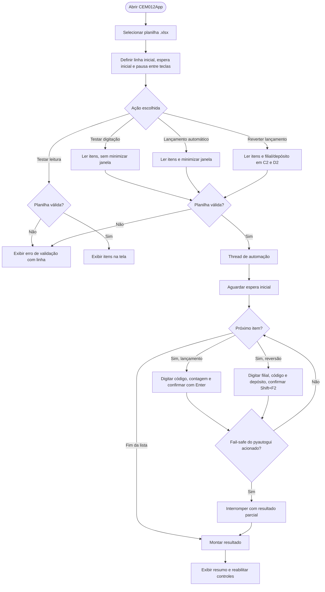

# Automação de Lançamento de Inventário (CEM012)

Aplicação desktop em Python/Tkinter que lê uma planilha de contagem de inventário (`.xlsx`) e digita os itens automaticamente no ERP, usando `pyautogui` para simular o teclado. Também possui modo de reversão do lançamento.

## Componentes

| Arquivo | Função |
|---|---|
| `inventory_app.py` | Interface gráfica (Tkinter), validação do formulário e threads de automação |
| `inventory_launcher.py` | Leitura da planilha, regras de negócio e sequências de teclas (sem GUI) |
| `diagnostico_planilha.py` | Script de diagnóstico: mostra células brutas e valida a planilha no terminal |
| `test_inventory_launcher.py` | Testes unitários da lógica de leitura, formatação e digitação |
| `test_inventory_app.py` | Testes unitários da validação de campos e formatação de saída |
| `AutomacaoInventario.spec` | Configuração PyInstaller (nome antigo do executável) |
| `CEM012App v2.2.spec` | Configuração PyInstaller da versão atual (`CEM012App v2.2.exe`) |

## Formato da planilha

Aba ativa do arquivo `.xlsx`:

| Local | Conteúdo |
|---|---|
| Linha 1 | Cabeçalho (ignorado) |
| `A{n}` | Código do item |
| `B{n}` | Contagem (aceita vírgula ou ponto decimal; não pode ser vazia nem negativa) |
| `C2` | Código da filial (usado na reversão) |
| `D2` | Código do depósito (usado na reversão) |

Linhas com código e contagem vazios são ignoradas. Linha com apenas um dos dois campos gera erro com o número da linha.

## Fluxo de execução



## Pré-requisitos

- Windows (o ERP e o `pyautogui` operam sobre a janela ativa)
- Python 3.11+
- Dependências: `pip install -r requirements.txt`

## Uso

1. Abra o ERP na tela de lançamento. No modo terminal, o primeiro item deve ser lançado manualmente antes do início automático.
2. Execute `CEM012App v2.2.exe` ou `python inventory_app.py`.
3. Selecione a planilha e confira a linha inicial (padrão `3`).
4. Use **Testar leitura** para validar os dados sem digitar nada.
5. Use **Testar digitação** para digitar sem minimizar a janela e acompanhar.
6. Use **Lançamento automático** para executar. Durante a execução, mova o mouse para o canto superior esquerdo da tela para acionar o fail-safe e interromper.
7. **Reverter lançamento** usa o mesmo fluxo com a sequência de reversão.

Terminal (sem GUI):

```bash
python inventory_launcher.py --planilha inventario.xlsx --linha-inicial 3 --espera-inicial 10 --pausa-tecla 0.2
python inventory_launcher.py --planilha inventario.xlsx --simular   # só imprime itens
```

## Testes

```bash
pip install -r requirements.txt
pytest -q
```

## Build do executável

```bash
pyinstaller "CEM012App v2.2.spec"
```

O resultado é gerado em `dist/`. Essas pastas e as planilhas reais **não** são versionadas (ver `.gitignore`).

## Observações

- A sequência de teclas é específica da tela do ERP. Qualquer mudança de layout do ERP exige ajuste em `launch_entry` e `revert_entry` (`inventory_launcher.py`).
- `CEM012App v2.2.spec` e `AutomacaoInventario.spec` diferem apenas no nome do executável.
